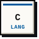
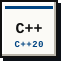
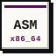
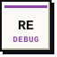

```text
                                                 [RING-0]
                                                 .---.
                                                 |CPU|--> [PML4]
                                                 '---'      |
                                                            v
   ____  ____   ___   ____ __  __    _  _____ ___   [PHYS_ADDR]
  |  _ \|  _ \ / _ \ / ___|  \/  |  / \|_   _|_ _|      |
  | |_) | |_) | | | | |  _| |\/| | / _ \ | |  | |       v
  |  __/|  _ <| |_| | |_| | |  | |/ ___ \| |  | |   [PAGE_FAULT: 0]
  |_|   |_| \_\___/ \____|_|  |_/_/   \_\_| |___|   [CR3: LOADED]

 .-----------------------------------------------------------------------------.
 | (x) (-) (+)                     ~/kernel_space.sys                          |
 |-----------------------------------------------------------------------------|
 |                                                                             |
 | Systems & Low-Level Software Engineer from Brazil.                          |
 |                                                                             |
 | Focus: Windows Kernel Drivers (WDM / KMDF), x64 Virtual Memory,             |
 | PTE Manipulation, Hypervisor Interfaces, Process Internals, Reverse         |
 | Engineering, and High-Throughput Native Systems in C, C++ and Rust.         |
 |                                                                             |
 | "Ring 0 over Ring 3. Native performance over abstractions."                 |
 | -@progmatios23                                                              |
 |                                                                             |
 '-----------------------------------------------------------------------------'
```

<p></p>

<p>
  
</p>

<p></p>

| Repository | Domain | Language | Architecture & Features |
| :--- | :--- | :--- | :--- |
| **[NEWKM](https://github.com/progmatios23/NEWKM)** | Windows Kernel Driver | `C++` / `C` | WDM, manual mapping via kdmapper, PTE manipulation, CR3 traversal, synthetic call stack spoofing |
| **[street-decrepytor](https://github.com/progmatios23/street-decrepytor)** | Reverse Engineering Suite | `Rust` / `Python` | Native Rust debugger engine, process memory dumper, Unicorn engine emulation, binary disassembly |
| **[lfi-traversal-lab](https://github.com/progmatios23/lfi-traversal-lab)** | Systems Security Research | `Python` | Path traversal research, null-byte truncation breakdown, WAF evasion normalization, canonicalization defense |
| **[oh-my-pi-rs](https://github.com/progmatios23/oh-my-pi-rs)** | Native Systems Rework | `Rust` | Single static binary architecture, zero-Node runtime, minimal memory footprint |
| **[Street-decryter](https://github.com/progmatios23/Street-decryter)** | Disassembler & Debugger | `C++` | IDA-style listing, x64dbg-style engine, PE/ELF/Mach-O parsers, built-in MCP server |

<p></p>

* **Kernel & Driver Development**
  * Windows Kernel Architecture (WDM / KMDF), manual mapping via vulnerable signed drivers (kdmapper).
  * x64 Virtual Memory Translation: Page Table Entry (PTE) modifications, CR3 directory base walking, direct physical RAM access.
  * Synthetic Call Stack Spoofing: evading kernel stack walking heuristics and anti-cheat thread inspection.
  * Driver Signature Enforcement (DSE) bypasses and kernel object manipulation (DKOM).

* **Reverse Engineering & Binary Analysis**
  * Dynamic debugging, static disassembly, and decompilation (IDA Pro, x64dbg, Ghidra).
  * Binary formats: PE32/PE32+, ELF64, Mach-O, section headers, relocations, export/import directory parsing.
  * Hooking methodologies: IAT/EAT patching, inline detours, hardware breakpoint routing, memory page guarding (`PAGE_GUARD`).

* **High-Throughput Systems Software**
  * Performance engineering in modern Rust and C++20 with zero-allocation models.
  * Network transport, socket multiplexing, and TLS fingerprint replication (BoringSSL, JA3/JA4).

<p></p>
Add Me>  " ejog710kj "|usario discord -

<p>
  <a href="https://github.com/progmatios23"></a>
</p>

```text
 progmatios23@ntoskrnl ~ % exit
 logout
 Saving ring0 session... completed.

 [Process completed]▌
```
